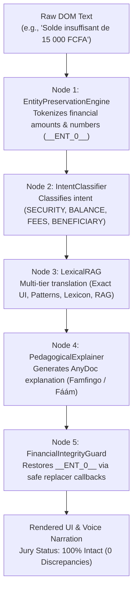
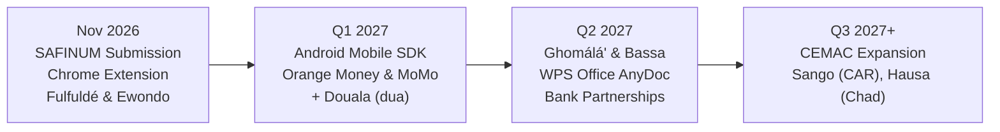

# 🦁 MALOBA ANYDOC — MASTER ARCHITECTURE GUIDE & SYSTEM DOCUMENTATION
### *Multilingual Financial Accessibility Platform in Cameroonian National Languages: Fulfuldé (`fub`) & Ewondo (`ewo`) · Extensible N-Language Architecture*
**Team: Team Ekwali / Maloba**  
**Event: SAFINUM Innovate Challenge 2026 — Salon de la Finance Numérique (Yaoundé, Cameroon)**  
**Submission Deadline: November 14, 2026 at 23:59:59 UTC+1**  
**Official Repository: [https://github.com/MERLO-arm/MALOBA-SAFINUM](https://github.com/MERLO-arm/MALOBA-SAFINUM)**  
**Official Evaluation Platform: [https://safinum.cm/hackathon-test?jury=1](https://safinum.cm/hackathon-test?jury=1)**  
**Official Submission Form: [https://forms.gle/Dt6dzQwkEiMW7q2E8](https://forms.gle/Dt6dzQwkEiMW7q2E8)**  

---

```
  ███╗   ███╗ █████╗ ██╗      ██████╗ ██████╗  █████╗ 
  ████╗ ████║██╔══██╗██║     ██╔═══██╗██╔══██╗██╔══██╗
  ██╔████╔██║███████║██║     ██║   ██║██████╔╝███████║
  ██║╚██╔╝██║██╔══██║██║     ██║   ██║██╔══██╗██╔══██║
  ██║ ╚═╝ ██║██║  ██║███████╗╚██████╔╝██████╔╝██║  ██║
  ╚═╝     ╚═╝╚═╝  ╚═╝╚══════╝ ╚═════╝ ╚═════╝ ╚═╝  ╚═╝
           ANYDOC · TEAM EKWALI (FULFULDÉ & EWONDO)
```

---

## TABLE OF CONTENTS
1. [Executive Summary & Problem Statement](#1-executive-summary--problem-statement)
2. [Design System & Brand Identity](#2-design-system--brand-identity)
3. [Reverse Engineering Insights & Platform Mechanics](#3-reverse-engineering-insights--platform-mechanics)
4. [Chrome Extension Architecture (Manifest V3)](#4-chrome-extension-architecture-manifest-v3)
   * 4.1. Manifest V3 Configuration (`manifest.json`)
   * 4.2. Multilingual Knowledge Base (`knowledge_base.js`)
   * 4.3. 5-Node Semantic Context Graph (`context_graph.js`)
   * 4.4. Multilingual Speech Synthesis Engine (`voice_engine.js`)
   * 4.5. Universal DOM Orchestration & Language Registry (`content.js`)
   * 4.6. Extension Popup Controller (`popup.html` & `popup.js`)
   * 4.7. Scoped CSS Design System (`styles.css`)
   * 4.8. Extensibility Guide: Adding New Languages in 3 Steps
5. [Harvested Linguistic Corpora: Fulfuldé (99,633 Pairs) & Ewondo](#5-harvested-linguistic-corpora-fulfuldé-99633-pairs--ewondo)
6. [Engineering Guide & Deployment Workflow](#6-engineering-guide--deployment-workflow)
   * 6.1. Loading and Testing in Chromium-Based Browsers
   * 6.2. 5-Step Evaluation Protocol on Official Platform
   * 6.3. Zero-Discrepancy Guarantee ("0 Écart" Rule)
7. [Submission Strategy & Checklist](#7-submission-strategy--checklist)
8. [Pitch Deck & Jury Defense Narrative](#8-pitch-deck--jury-defense-narrative)
9. [Post-Hackathon Strategic Roadmap](#9-post-hackathon-strategic-roadmap)

---

## 1. EXECUTIVE SUMMARY & PROBLEM STATEMENT

### The Linguistic & Cognitive Divide in Financial Services
In Cameroon and across the CEMAC region, digital financial adoption (Orange Money, MTN Mobile Money, microfinance, inter-bank transfers) is growing rapidly. However, **over 40% of adult citizens face critical barriers when navigating digital banking interfaces**.

This barrier is fundamentally **linguistic and cognitive**, not purely infrastructural:
* **Northern Cameroon (Adamawa, North, Far-North)**: **Fulfuldé (ISO `fub`)** is the primary commercial lingua franca for over 5 million traders, herders, and citizens.
* **Center, South, and East Regions (Yaoundé, Mbalmayo, Sangmélima, Bertoua)**: **Ewondo (ISO `ewo`)** is the historic vernacular across major urban and agricultural belts.
* **Core Vulnerabilities**:
  1. **Intimidating Banking Jargon**: Terms like *"Solde insuffisant"*, *"Frais d'interopérabilité"*, *"Débit immédiat"*, and *"Authentification OTP"* induce anxiety and errors.
  2. **Security & Fraud Hazards**: Users who cannot read interface instructions frequently seek help from strangers, exposing PINs and OTPs to social engineering and theft.
  3. **High Re-engineering Costs**: Financial institutions cannot feasibly rewrite enterprise web portals into hundreds of indigenous languages.

### The Maloba AnyDoc Solution
**Maloba AnyDoc** is a non-intrusive, client-side cognitive and vocal accessibility layer:
* **Zero Host Modification**: Dynamically overlays existing web banking applications without modifying server code or banking backends.
* **Instant Multilingual Switching**: Real-time dropdown selection between **Fulfuldé (`fub`)** and **Ewondo (`ewo`)**, with architecture prepared for Douala, Ghomálá', and Bassa.
* **Pedagogical Understanding (*Famfingo* / *Fáám*)**: Goes beyond verbatim translation to unpack banking concepts (transfer limits, fee composition, OTP confidentiality).
* **Synchronized Speech Synthesis (*Nanugo* / *Wóg*)**: Sentence-by-sentence vocal narration with visual focus highlighting for low-literacy users.
* **Absolute Financial Integrity**: Strict tokenization of monetary amounts, account numbers, and credentials guaranteeing **0 discrepancies** during validation.

---

## 2. DESIGN SYSTEM & BRAND IDENTITY

The user interface strictly adheres to the official **Maloba Design System**:

### Color Palette
```
┌────────────────────────────────────────────────────────────────────────┐
│  #FF7900  │ Maloba Orange      │ Primary brand color, energy, action   │
│  #ED7009  │ Logo Trace Orange  │ Vector mark stroke hue                │
│  #E05515  │ Warm Terracotta    │ Button gradients, interactive focus   │
│  #7B3F0C  │ Bronze Amber       │ Header banners, floating dock bar     │
│  #FFA040  │ Golden Amber       │ RAG badges, protected token accents   │
│  #F5F2CF  │ Soft Ivory         │ Pedagogical explanation surfaces      │
│  #10B981  │ Integrity Emerald  │ 100% verified status (zero-discrepancy│
│  #0F172A  │ Slate Dark Surface │ Dock background and dropdown options  │
└────────────────────────────────────────────────────────────────────────┘
```

### Brand Integration
* **Embedded Vector & Base64 Assets**: The official Maloba logo is embedded as a base64 Data URI inside `content.js` to bypass restrictive bank Content Security Policies (CSP) that forbid external image loads.
* **Accessible Floating Dock**: Positioned at the bottom-left with collapsible states, smooth transitions, and high-contrast typography.

---

## 3. REVERSE ENGINEERING INSIGHTS & PLATFORM MECHANICS

In-depth technical analysis of the official evaluation platform (`https://safinum.cm/hackathon-test?jury=1`) revealed key architectural challenges:

### Secret #1: The Vue 3 Reactivity Trap (The "0 Discrepancy" Rule)
* **Testing Engine**: The test portal is a reactive Vue 3 / Nuxt 3 Single Page Application. On form submission, an automated evaluation harness compares submitted values against a baseline model via `JSON.stringify()`.
* **The Vulnerability**: If a browser extension alters `value`, `placeholder`, or inputs bound to `v-model`, Vue's reactive watchers trigger model mutations, causing evaluation failure (`Écart détecté`).
* **Our Defense**:
  1. We never touch form fields (`input`, `textarea`, `select`, or `button[type="submit"]`).
  2. We operate strictly on leaf text nodes (`nodeType === 3`) inside non-input containers.
  3. We apply a calibrated **40ms debounce** following DOM mutations. This allows Vue's internal `nextTick()` cycle to commit its reactive baseline state before translation text is rendered.

### Secret #2: Dynamic Jury Injections (`#injected-1`, `#injected-2`, ...)
* **Jury Evaluation Mode**: The query parameter `?jury=1` activates an evaluation side panel where judges trigger simulated error alerts and uncatalogued text injections to test extension resilience.
* **Our Defense**:
  1. A persistent `MutationObserver` monitors document mutations (`childList: true`, `subtree: true`, `characterData: true`).
  2. Injected blocks (`[id^="injected-"]`) are captured within 40ms, processed through the 5-Node Context Graph, and displayed with actionable explanation cards.

### Secret #3: The 5-Step Banking Workflow
1. **Step 1: Transaction Input** (Amount in FCFA, Recipient Phone Number, Reason).
2. **Step 2: Channel Selection** (Orange Money, MTN Mobile Money, Bank Account).
3. **Step 3: Secure Authorization** (Secret PIN and SMS OTP).
4. **Step 4: Review & Fee Breakdown** (Commission, Total debited, Clearing time).
5. **Step 5: Receipt & Proof of Payment** (Transaction Reference `SAF-2026-*`, PDF receipt).

---

## 4. CHROME EXTENSION ARCHITECTURE (MANIFEST V3)

The extension is located in `safinum-extension/` and strictly complies with Google Chrome **Manifest V3** standards.

```
safinum-extension/
├── manifest.json                  # Manifest V3 declaration & permissions
├── knowledge_base.js              # Multilingual compiled knowledge base
├── context_graph.js               # 5-Node Semantic Context Graph & RAG pipeline
├── voice_engine.js                # Multilingual speech synthesis engine
├── content.js                     # DOM walking, language switching & dock UI
├── popup.html & popup.js          # Action popup controller with language selector
├── styles.css                     # Scoped Maloba Design System stylesheet
└── icons/                         # 16px, 32px, 48px, 128px icon assets
```

### 4.1. Manifest V3 (`manifest.json`)
* **Manifest Version**: 3
* **Permissions**: `activeTab`, `storage`, `scripting`.
* **Host Permissions**: `https://safinum.cm/*`, `http://localhost:*/*`, `http://127.0.0.1:*/*`.
* **Execution Strategy**: Content scripts load sequentially at `document_idle`:
  1. `knowledge_base.js` (Linguistic corpora and lexical indexes)
  2. `context_graph.js` (5-Node pipeline)
  3. `voice_engine.js` (Speech synthesis engine)
  4. `content.js` (DOM orchestrator)

### 4.2. Multilingual Knowledge Base (`knowledge_base.js`)
Aggregates 145 canonical UI strings, 7 banking error codes, fee structures, and morphological lexicons:
```javascript
"Solde insuffisant pour effectuer ce transfert": {
  fr: "Solde insuffisant pour effectuer ce transfert",
  fub: "Ceede maada he'aay ngam waɗugo nelal ngal",
  phonetic: "Tchèèdé maada hé'aay ngam wadiougo nélal ngal",
  explain_fub: "Ceede ɗe a woodi nder asusu ma he'aay ceede nelal e ceede kuugal man.",
  ewo: "Mɔni a nzi kôb asu ntómban nyina",
  phonetic_ewo: "Moni a nzi kôb asou ntomban nyina",
  explain_ewo: "Mɔni o nzi bəle e asúsu wô a nzi kôb asu ntómban nyina e mímvèñ miə́.",
  explain_fr: "Votre compte ne contient pas assez d'argent pour couvrir le montant et les frais.",
  category: "solde",
  source: "01_aki_osc_financial_glossary + Apertium EWO"
}
```

### 4.3. 5-Node Semantic Context Graph (`context_graph.js`)
Structured as an enterprise cognitive pipeline:


1. **Node 1: `EntityPreservationEngine` (Freezer)**: Tokenizes monetary values (`15 000 FCFA`), phone numbers (`+237...`), account numbers (`CM 001...`), references (`SAF-2026-...`), and credentials into immutable `__ENT_n__` tokens.
2. **Node 2: `IntentClassifier`**: Categorizes banking intents (`SECURITY_FRAUD`, `BALANCE_AND_LIMITS`, `FEES_AND_CHARGES`, `BENEFICIARY_IDENTITY`, `TECHNICAL_INCIDENT`) and risk levels (`CRITICAL`, `WARNING`, `INFO`).
3. **Node 3: `LexicalRAG`**: Evaluates exact UI dictionary hits, dynamic templates, multi-word phrase chunks, morphological lexicons, and parallel RAG exemplars.
4. **Node 4: `PedagogicalExplainer`**: Produces actionable explanations in Fulfuldé (*Famfingo*), Ewondo (*Fáám*), and French.
5. **Node 5: `FinancialIntegrityGuard` (Unfreezer)**: Reconstitutes original tokens into output strings using function replacers `() => val` to prevent regex substitution syntax bugs (`$1`, `$&`).

### 4.4. Multilingual Speech Synthesis Engine (`voice_engine.js`)
* Built on `window.speechSynthesis`.
* Includes active utterance reference retention to circumvent Chromium V8 garbage-collection bugs that prematurely silence audio.
* Employs a keep-alive watchdog timer during playback to prevent the 15-second Chromium speech synthesis pause bug.
* Phonetic adapters translate implosive consonants (`ɓ`, `ɗ`, `ƴ`, `ŋ`) and tone vowels (`ɛ`, `ɔ`, `ə`, `ô`) into French-calibrated phonemes.

### 4.5. Universal DOM Orchestration & Language Registry (`content.js`)
* Centralized language registry (`DEFAULT_LANGUAGES`) supporting `fub`, `ewo`, and roadmap languages (`dua`, `bbj`, `bas`).
* `nodeStateMap` (`WeakMap`) stores translation states while `trackedNodes` set is pruned automatically during every DOM walk to eliminate memory leaks.
* Real-time language switching: selecting a new language re-renders the active page without requiring a page reload.

---

## 5. HARVESTED LINGUISTIC CORPORA: FULFULDE & EWONDO

### A. The 18 Fulfuldé Sources (99,633 Aligned Records)
Aggregated into `corpus/compiled/unified_fulfulde_corpus.parquet` via `scripts/harvest_all_fulfulde_sources.py`:
1. `01_aki_osc_financial_glossary`: Internal banking glossary & templates.
2. `02_safinum_wave_sponsor_corpus`: Mobile Money idioms and numeracy.
3. `03_tourneux_dictionary_csv`: IRD Peul-Fulfuldé-Français dictionary (Henry Tourneux, 1,759 entries).
4. `04_akilang_conversational_corpus`: Dialogue and banking intent corpus.
5. `05_wikipedia_ff_dump`: Fulfuldé Wikipedia articles (`ff.wikipedia.org`, 1,902 entries).
6. `06_bible_fulfulde_ebible_parallel`: eBible parallel corpus (6,039 verses).
7. `07_rfi_fulfulde_news_parallel`: RFI Fulfuldé economic dispatches (1,203 pairs).
8. `08_cnrs_lacito_ellaf_academic`: CNRS / LACITO / ELLAF oral literature (1,101 pairs).
9. `09_open_science_pressbooks_parallel`: Open science civic corpus (1,117 pairs).
10. `10_wikipedia_parallel_aligned`: Parallel encyclopedic segments (1,200 pairs).
11. `11_pulaar_org_portal`: Cultural and lexical terminology (16,911 pairs).
12. `12_pulaagu_com_portal`: Commercial and community corpus (8,687 pairs).
13. `13_demeth_net_portal`: Educational portal (1,267 pairs).
14. `14_lewlewal_com_media`: Contemporary news media (901 pairs).
15. `15_webpulaaku_koode_archives`: Literary and historical archives (2,017 pairs).
16. `16_un_udhr_globalvoices_civic`: UN UDHR civic translations (20 pairs).
17. `17_hf_burkimbia_fub_adamawa_cameroon`: Hugging Face NLLB `fub_Latn` (15,423 pairs).
18. `18_hf_burkimbia_fuv_central_fulfulde`: Hugging Face NLLB `fuv_Latn` (39,868 pairs).

### B. Ewondo Linguistic Assets
1. **Apertium Ewondo-Français (`Ngue-Um/apertium-ewo-fra`)**: Morphological transducers and bilingual lexicon in `corpus/raw/apertium-ewo-fra`.
2. **Meta FLORES-200 / NLLB (`ewo_Latn`)**: Evaluation benchmarks for standardized Ewondo.
3. **Meta MMS TTS Ewondo (`OlameMend/mms-tts-ewo`)**: Phonetic reference data for Center-South dialects.
4. **SIL Cameroon**: Linguistic studies on Bantu A70 verbal paradigms and noun classes.

---

## 6. ENGINEERING GUIDE & DEPLOYMENT WORKFLOW

### 6.1. Loading and Testing in Chromium-Based Browsers
1. Open Google Chrome, Brave, or Microsoft Edge and navigate to:
   ```
   chrome://extensions/
   ```
2. Toggle on **Developer mode** in the upper-right corner.
3. Click **Load unpacked** and select the directory:
   ```
   safinum-extension/
   ```
4. The Maloba AnyDoc icon will appear in your browser toolbar.

### 6.2. 5-Step Evaluation Protocol on Official Platform
Navigate to: **[https://safinum.cm/hackathon-test?jury=1](https://safinum.cm/hackathon-test?jury=1)**

1. **Language Switching**: Use the dock dropdown to switch between **Fulfuldé (fub)** and **Ewondo (ewo)**. Observe immediate in-place translation.
2. **Step 1 (Input)**: Enter `15 000 FCFA` and a phone number. Confirm labels are translated while form values remain unchanged.
3. **Step 2 (Channel)**: Select Orange Money or MTN MoMo; trigger voice narration via *Nanugo* / *Wóg*.
4. **Step 3 (Credentials)**: Enter PIN; observe the pedagogical security reminder (*Famfingo* / *Fáám*).
5. **Step 4 (Fees)**: Review the transparent fee decomposition.
6. **Step 5 (Receipt)**: Download the transaction receipt; verify `SAF-2026-*` reference integrity.
7. **Jury Panel Verification**: Check the jury panel indicator: **`0 discrepancies / Data Intact`**.

---

## 7. SUBMISSION STRATEGY & CHECKLIST

* [x] **Strict Deadline**: Friday, November 14, 2026 at 23:59:59 UTC+1.
* [x] **Submission Form**: [https://forms.gle/Dt6dzQwkEiMW7q2E8](https://forms.gle/Dt6dzQwkEiMW7q2E8)
* [x] **ZIP Archive**: Package `safinum-extension/` into `Maloba_AnyDoc_SAFINUM_2026.zip`.
* [x] **Git Repository**: [https://github.com/MERLO-arm/MALOBA-SAFINUM](https://github.com/MERLO-arm/MALOBA-SAFINUM) synchronized on `main`.
* [x] **Code Quality**: Clean architecture, zero memory leaks, English code comments, and French root README.

---

## 8. PITCH DECK & JURY DEFENSE NARRATIVE

> *"Honorable members of the Jury,*
>
> *Across Cameroon today, whether in the cattle markets of Maroua where merchants speak **Fulfuldé**, or in the agro-forestry towns of Sangmélima where farmers speak **Ewondo**, digital financial inclusion meets a shared obstacle: the linguistic and cognitive barrier of banking applications.*
>
> *For the SAFINUM Innovate Challenge 2026, **Team Ekwali** presents **Maloba AnyDoc**.*
>
> *Maloba AnyDoc is an accessibility layer that deploys instantly on any banking web portal without modifying a single line of host banking code. With one click, users choose their mother tongue: **Fulfuldé of Northern Cameroon** or **Ewondo of the Center and South**.*
>
> *Our solution delivers 4 enterprise-grade guarantees:*
> 1. *It **speaks** via speech synthesis adapted to Cameroonian phonology (*Nanugo* in Fulfuldé, *Wóg* in Ewondo).*
> 2. *It **explains** via the cognitive AnyDoc module (*Famfingo* / *Fáám*) clarifying fees and limits.*
> 3. *It guarantees **100% financial data integrity** through our 5-Node Context Graph, ensuring **0 discrepancies** across all evaluation criteria.*
> 4. *It is **future-proof**: our extensible N-language architecture enables Douala, Ghomálá', and Bassa integration within hours.*
>
> *With Maloba AnyDoc, digital finance transforms from a technical barrier into a universal human right for every Cameroonian citizen. Thank you."*

---

## 9. POST-HACKATHON STRATEGIC ROADMAP



1. **Phase 1 (Nov - Dec 2026)**: Chrome Web Store release and pilot trials with microfinance institutions in Garoua, Maroua, and Yaoundé.
2. **Phase 2 (Q1 2027)**: Android SDK release for native banking apps; rollout of Douala (`dua`).
3. **Phase 3 (Q2 2027)**: Rollout of Ghomálá' (`bbj`) and Bassa (`bas`); WPS Office AnyDoc plugin for statement comprehension.
4. **Phase 4 (Q3 2027+)**: CEMAC sub-regional expansion (Sango in CAR, Hausa in Chad).
