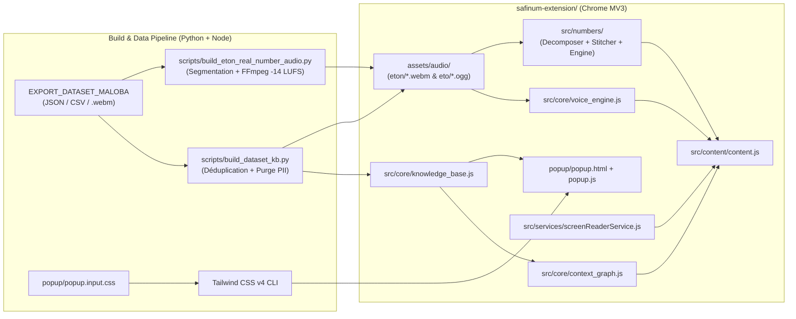

# Maloba AnyDoc — Accessibilité Financière Multilingue (SAFINUM 2026)

[](https://safinum.cm/hackathon-test)
[](safinum-extension/manifest.json)
[-100%25%20Verified%20Audio-10b981?style=for-the-badge)](#couverture-linguistique--dataset)
[](#tests--v%C3%A9rification)
[-0f172a?style=for-the-badge)](#s%C3%A9curit%C3%A9-confidentialit%C3%A9--int%C3%A9grit%C3%A9)

**Maloba AnyDoc** est une extension navigateur **Chrome Manifest V3** d'accessibilité financière multimodale conçue pour le **SAFINUM Innovate Challenge 2026** (Yaoundé, Cameroun). Elle traduit en place les interfaces bancaires et de Mobile Money en langues nationales camerounaises, restitue **de véritables enregistrements vocaux humains** (`.webm`), lit dynamiquement les montants en **FCFA** par assemblage morphémique sans synthèse artificielle (`.ogg`), et fournit un lecteur d'écran accessible pleine page.

---

## Sommaire

1. [Proposition de Valeur & Capacités Clés](#proposition-de-valeur--capacit%C3%A9s-cl%C3%A9s)
2. [Couverture Linguistique & Dataset](#couverture-linguistique--dataset)
3. [Architecture Technique](#architecture-technique)
4. [Structure du Dépôt](#structure-du-d%C3%A9p%C3%B4t)
5. [Installation Rapide (Mode Utilisateur / Jury)](#installation-rapide-mode-utilisateur--jury)
6. [Configuration Développeur & Pipeline de Build](#configuration-d%C3%A9veloppeur--pipeline-de-build)
7. [Tests & Vérification](#tests--v%C3%A9rification)
8. [Sécurité, Confidentialité & Intégrité](#s%C3%A9curit%C3%A9-confidentialit%C3%A9--int%C3%A9grit%C3%A9)
9. [Ajouter une Nouvelle Langue](#ajouter-une-nouvelle-langue)
10. [Documentation Complémentaire](#documentation-compl%C3%A9mentaire)

---

## Proposition de Valeur & Capacités Clés

* **Traduction Déterministe Sans Hallucination (`context_graph.js`)** : Toute chaîne UI (Français ou Anglais) est résolue strictement par correspondance exacte, normalisée ou patron dynamique vérifié dans `knowledge_base.js`. Tout texte hors-catalogue retourne `null` afin de garantir zéro traduction inventée.
* **Sanctuarisation Financière Absolue** : Les montants (`15 000 FCFA`), numéros de téléphone (`+237 670 00 00 00`), IBAN/identifiants de compte (`CM21 ...`), références (`SAF-2026-0042`) et jetons sensibles (`PIN`, `OTP`) ne sont **jamais** altérés.
* **Audio Humain Réel (`.webm`) (`voice_engine.js`)** : Lecture directe des enregistrements humains issus de `EXPORT_DATASET_MALOBA`, avec explications pédagogiques associées (*Ndimzana* en Éton).
* **Lecteur de Montants par Assemblage Morphémique (`numberDecomposer.js` + `audioStitcherPlayer.js` + `safinumEngine.js`)** : Décomposition de tout montant entier jusqu'aux millions en un corpus canonique de **42 clés audio** (`.ogg` 48 kHz mono normalisé `-14 LUFS` EBU R128) assemblées sans coupure via l'API Web Audio.
* **Lecteur d'Écran Pleine Page (`screenReaderService.js`)** : Parcours séquentiel des éléments visibles avec mise en surbrillance, contrôles Lecture / Pause / Arrêt, et raccourcis clavier.
* **100 % Embarqué & Hors-Ligne** : Aucun appel réseau externe au runtime ; tous les dictionnaires et fichiers audio sont packagés localement dans l'extension.

---

## Couverture Linguistique & Dataset

La base de connaissances embarquée est compilée depuis `EXPORT_DATASET_MALOBA/` par `scripts/build_dataset_kb.py` (192 enregistrements vérifiés, 191 fichiers audio `.webm`, 281 entrées d'index UI exactes, 69 entrées numériques, 15 commandes vocales) :

| Langue | Code ISO 639-3 | Région | Statut | Progression Dataset |
| :--- | :--- | :--- | :--- | :--- |
| **Éton** | `eto` | Centre (Lekié, Mfoundi) | **Actif (Production)** | **100 %** (192 / 192 + 42 clés nombres `.ogg`) |
| **Ghomálá'** | `bbj` | Ouest (Hauts-Plateaux) | Collecte en cours | 24 % (46 / 192) |
| **Duala** | `dua` | Littoral (Wouri) | Collecte en cours | 13 % (25 / 192) |
| **Lámnso'** | `lns` | Nord-Ouest (Bui) | Collecte en cours | 8 % (16 / 192) |
| **Fulfuldé** | `fub` | Grand-Nord | Roadmap / Corpus brut | En attente de collecte voix |
| **Ewondo** | `ewo` | Centre, Sud, Est | Roadmap / Corpus brut | En attente de collecte voix |
| **Bassa** | `bas` | Centre, Littoral | Roadmap | En attente de collecte voix |

---

## Architecture Technique



### Ordre d'injection Content Script (`manifest.json`)

1. `src/core/knowledge_base.js` — Base lexicale compilée (`window.SAFINUM_KB`)
2. `src/core/context_graph.js` — Moteur de résolution déterministe & garde d'intégrité (`window.SafinumContextGraph`)
3. `src/numbers/numberDecomposer.js` — Décomposition numérique vers les 42 clés canoniques
4. `src/numbers/audioStitcherPlayer.js` — Lecteur Web Audio API avec préchargement et enchaînement fluide
5. `src/numbers/safinumEngine.js` — Façade haut niveau pour la lecture des montants (`window.SafinumWebNumberEngine`)
6. `src/core/voice_engine.js` — Lecteur des fichiers `.webm` humains (`window.SafinumVoiceEngine`)
7. `src/services/screenReaderService.js` — Service de lecture accessible de la page
8. `src/content/content.js` — Orchestrateur DOM, dock flottant Maloba, bulle contextuelle et observateur SPA

---

## Structure du Dépôt

```text
MALOBA-SAFINUM/
├── README.md                                  # Documentation principale du projet
├── package.json                               # Scripts NPM (build CSS, build KB, build nombres, tests)
├── .gitignore                                 # Exclusions Git (node_modules, caches Python/HF, .env)
│
├── safinum-extension/                         # Extension Chrome Manifest V3 (prête à charger)
│   ├── manifest.json                          # Descripteur MV3, permissions et ressources accessibles
│   ├── popup/
│   │   ├── popup.html                         # Interface popup de contrôle
│   │   ├── popup.js                           # Logique de la popup (langue, mode, testeur de montant)
│   │   ├── popup.input.css                    # Source Tailwind CSS v4 (tokens Maloba)
│   │   └── popup.css                          # Feuille de style compilée et minifiée
│   ├── src/
│   │   ├── content/
│   │   │   ├── content.js                     # Traduction DOM in-place, dock flottant & hover pill
│   │   │   └── styles.css                     # Styles injectés dans les pages cibles
│   │   ├── core/
│   │   │   ├── knowledge_base.js              # Base de connaissances générée automatiquement
│   │   │   ├── context_graph.js               # Moteur de recherche exacte/normalisée & intégrité
│   │   │   └── voice_engine.js                # Lecture audio humaine .webm
│   │   ├── numbers/
│   │   │   ├── numberDecomposer.js            # Décomposeur numérique 42 clés
│   │   │   ├── audioStitcherPlayer.js         # Assembleur Web Audio API
│   │   │   └── safinumEngine.js               # Façade lecture de montants
│   │   └── services/
│   │       └── screenReaderService.js         # Lecteur d'écran pleine page
│   ├── assets/
│   │   └── audio/                             # Ressources audio embarquées (eton/*.webm, eto/*.ogg, ...)
│   └── icons/                                 # Icônes officielles Maloba (16, 32, 48, 128 px, SVG)
│
├── src/                                       # Sources TypeScript de référence (architecture & typage)
│   ├── components/safinumFloatingWidget.ts
│   ├── numbers/
│   │   ├── audioStitcherPlayer.ts
│   │   ├── numberDecomposer.ts
│   │   └── safinumEngine.ts
│   └── services/screenReaderService.ts
│
├── scripts/                                   # Pipelines de compilation Python
│   ├── build_dataset_kb.py                    # Compile EXPORT_DATASET_MALOBA -> knowledge_base.js + .webm
│   ├── build_eton_real_number_audio.py        # Construit le corpus 42 clés .ogg Éton depuis les .webm réels
│   └── generate_number_audio_corpus.py        # Générateur de corpus numériques .ogg normalisés (-14 LUFS)
│
├── tests/
│   └── verify_extension.js                    # Suite de vérification automatisée (12 tests d'intégrité)
│
├── docs/
│   ├── DOCUMENTATION_COMPLETE.md              # Spécification technique détaillée du projet
│   └── PRESELECTION_SAFINUM_2026.pdf          # Cahier des charges officiel SAFINUM 2026
│
├── EXPORT_DATASET_MALOBA/                     # Dataset officiel collecté (CSV, JSON, audios par langue)
└── corpus/                                    # Corpus linguistiques bruts et compilés (Parquet, PDF, Apertium)
```

---

## Installation Rapide (Mode Utilisateur / Jury)

Aucune compilation n'est nécessaire pour tester l'extension : `safinum-extension/` est déjà prêt pour la production.

1. Ouvrir **Google Chrome**, **Microsoft Edge** ou **Brave** et accéder à :
   ```text
   chrome://extensions/
   ```
2. Activer le **Mode développeur** (*Developer mode*) en haut à droite.
3. Cliquer sur **Charger l'extension non empaquetée** (*Load unpacked*) et sélectionner le dossier :
   ```text
   MALOBA-SAFINUM/safinum-extension
   ```
4. Ouvrir la plateforme d'évaluation SAFINUM :
   **[https://safinum.cm/hackathon-test](https://safinum.cm/hackathon-test)**
5. Cliquer sur l'icône **Maloba AnyDoc** dans la barre d'extensions (ou utiliser le dock flottant injecté sur la page) pour activer la traduction en **Éton (`eto`)**, écouter les phrases et tester la lecture vocale des montants.

---

## Configuration Développeur & Pipeline de Build

### Prérequis

* **Node.js** ≥ 18 (`npm` inclus) — requis pour Tailwind CSS v4 et la suite de tests.
* **Python** ≥ 3.10 — requis pour la compilation du dataset et des ressources audio.
* **FFmpeg** (optionnel, requis uniquement pour régénérer le corpus numérique `.ogg`) — disponible dans le `PATH`.

### Installation des dépendances

```bash
git clone https://github.com/MERLO-arm/MALOBA-SAFINUM.git
cd MALOBA-SAFINUM
npm install
```

### Commandes disponibles

| Commande | Rôle |
| :--- | :--- |
| `npm test` | Exécute la suite de vérification production (`tests/verify_extension.js`) |
| `npm run build:css` | Compile et minifie `safinum-extension/popup/popup.css` via Tailwind CSS v4 |
| `npm run watch:css` | Surveille `popup.input.css` et recompile automatiquement en développement |
| `npm run build:kb` | Recompile `EXPORT_DATASET_MALOBA/` vers `safinum-extension/src/core/knowledge_base.js` et copie les `.webm` vérifiés |
| `npm run build:numbers` | Régénère les 42 fichiers `.ogg` du lecteur de nombres Éton (`eto`) à `-14 LUFS` depuis les enregistrements humains |
| `npm run package` | Empaquette `safinum-extension/` en archive `.zip` prête pour distribution (`dist/maloba-anydoc-v<version>.zip`) |

---

## Tests & Vérification

Exécuter la suite de tests automatisée après toute modification :

```bash
npm test
```

La suite `tests/verify_extension.js` valide **12 invariants critiques** dans un environnement VM isolé :
1. Validité du `manifest.json` (MV3) et exposition `web_accessible_resources` (`assets/audio/eton/*.webm` et `assets/audio/eto/*.ogg`).
2. Absence totale de données personnelles (PII) ou de chaînes de test administrateur dans `knowledge_base.js`.
3. Existence sur disque et taille non nulle (> 1 Ko) de chacun des fichiers `.webm` référencés.
4. Résolution exacte depuis le Français (ex. `Solde` → `SAF_UI_005` + `SAF_EXP_005`).
5. Résolution exacte depuis l'Anglais (ex. `Balance` → `SAF_UI_005`).
6. Normalisation robuste (casse, espaces, ponctuation finale).
7. Patron dynamique de salutation préservant le nom de l'usager avec audio Éton réel.
8. Intégrité financière à 100 % sur les jetons sacrés (montants, téléphones, IBAN, références, `PIN`, `OTP`).
9. Zéro hallucination sur toute phrase arbitraire hors dataset (retour `null`).
10. Résolution d'URL `chrome-extension://` et arrêt propre sur `SafinumVoiceEngine`.
11. Intégrité du moteur numérique (`numberDecomposer.js` + `safinumEngine.js`) et présence des 42 fichiers `.ogg` Éton.
12. Chargement et initialisation de `ScreenReaderService` avec langue par défaut `eto`.

---

## Sécurité, Confidentialité & Intégrité

* **Purge PII automatisée** : `scripts/build_dataset_kb.py` supprime systématiquement `traducteur_nom`, `traducteur_telephone` et `user_id` lors de la compilation de `knowledge_base.js`, et exclut les enregistrements de test administrateur.
* **Permissions minimales (Moindre Privilège)** : L'extension déclare uniquement `activeTab`, `storage` et `scripting`, restreints à `https://safinum.cm/*`, `http://localhost:*/*` et `http://127.0.0.1:*/*`.
* **Zéro exfiltration** : Aucune télémétrie, aucun appel API tiers, aucune dépendance CDN distante.

---

## Ajouter une Nouvelle Langue

L'architecture N-langues permet d'activer une nouvelle langue nationale dès que sa collecte vocale atteint le seuil requis :

1. Ajouter le dossier de collecte dans `EXPORT_DATASET_MALOBA/<langue>/` conformément à [`EXPORT_DATASET_MALOBA/README_AGENT_IA.md`](EXPORT_DATASET_MALOBA/README_AGENT_IA.md).
2. Mettre à jour l'entrée correspondante dans `LANGUAGE_REGISTRY` (`active: True`) dans [`scripts/build_dataset_kb.py`](scripts/build_dataset_kb.py).
3. Exécuter `npm run build:kb` pour générer `knowledge_base.js` et copier les `.webm` vérifiés.
4. Exposer le dossier audio dans `web_accessible_resources` de [`safinum-extension/manifest.json`](safinum-extension/manifest.json) et valider avec `npm test`.

---

## Documentation Complémentaire

* **Spécification Technique Complète** : [`docs/DOCUMENTATION_COMPLETE.md`](docs/DOCUMENTATION_COMPLETE.md)
* **Protocole Dataset & Règles IA** : [`EXPORT_DATASET_MALOBA/README_AGENT_IA.md`](EXPORT_DATASET_MALOBA/README_AGENT_IA.md)
* **Cahier des Charges SAFINUM 2026** : [`docs/PRESELECTION_SAFINUM_2026.pdf`](docs/PRESELECTION_SAFINUM_2026.pdf)
